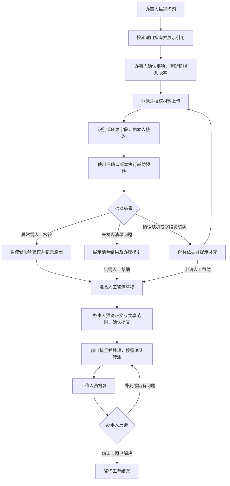

# 工作流梳理与落地建议

核查日期：2026年11月1日。本文是基于需求发现报告及当前工作区代码形成的分析建议，不是已经确认的客户需求或实施批准。本次不修改业务代码。

## 1. 结论

项目已经具备本地示例的问答、事项确认、材料辅助预检、确认建单、岗位接手与转派、答复和结案能力。下一步应围绕现有服务补齐三条流程的连接：

1. **办事流程**：咨询、确认事项和规则、材料授权与核对、辅助预检、补充材料、按需人工咨询。
2. **协同流程**：确认提交工单、窗口接手、按需业务复核、必要时主任协调、答复与办事人确认。
3. **规则改进流程**：问题反馈、业务负责人维护规则、监督员审核发布、新咨询使用新版本、旧记录保留原依据。

主要缺口是后台发布规则与预检计算没有形成统一版本闭环，其次是异常接手闭环、独立预检审计和统计口径。保留当前 FastAPI、数据库事务和有限工具智能体即可继续建设；当前没有必须引入独立工作流平台的证据。

需求发现报告明确来源为合成场景访谈。36%至18%、12分钟至5分钟和99%均是其中的待验证目标，不能视为已确认的真实业务基线或已达到的结果。报告中“继续追问”“下一步验证”和方法框架说明均作为分析素材处理。

## 2. 建议的业务流程



这里的“未发现清单问题”是材料清单层面的辅助结果。正式政务申请和行政审批仍走原法定流程，当前项目没有接入正式办件审批接口。

普通指南咨询可以不上传材料，也不必创建工单。无法确定事项时，沿用当前显式授权的人工分流路径，避免强行选入两类示例事项。

### 节点与现有实现

| 节点 | 当前实现 | 后续工作 |
| --- | --- | --- |
| 指南问答和引用 | `core/services/guide_qa.py`、`core/guide_rag.py`；独立问答和助手入口已存在 | 统一适用范围、版本和真实模型效果验证 |
| 事项、情形、规则确认 | `core/services/agent.py`、`infrastructure/agent_repository.py` | 继续以服务端确认记录和版本校验作为后续动作依据 |
| 材料上传、授权、核对 | `api/routes/materials.py`、`infrastructure/material_repository.py` | 对接真实材料字段；现有识别仅在明确启用的可信虚构示例模式下验证 |
| 辅助预检 | `core/services/materials.py` | 从固定教学JSON改为读取审核发布的结构化规则快照 |
| 草稿和确认建单 | `api/routes/agent.py`、`infrastructure/agent_repository.py`、`infrastructure/ticket_repository.py` | 复用当前版本确认、共享预览和幂等创建服务 |
| 岗位接手与答复 | `infrastructure/ticket_repository.py`、`api/routes/tickets.py` | 以实际事项授权和确认接手为责任转移依据 |
| 反馈与规则审核发布 | `infrastructure/knowledge_repository.py`、后台规则与发布页面 | 将指南、清单和可执行规则纳入同一发布版本 |

## 3. 工作人员如何流转

推荐正常路径为：窗口接手后直接处理普通咨询；专业问题转审核员，审核员按需分派；确需协调或升级的问题再交主任。业务负责人维护规则，监督员审核发布规则，热线查询授权进度并受理反馈，工程师负责接口与系统运行。

**主任不必成为每件咨询的固定审核节点。** 当前 `core/services/demo_cases.py` 中的11步案例固定经过窗口、审核员和主任，是用来展示跨岗协作的预设脚本。通用工单服务允许按实际需要处理和转派。

当前咨询工单状态：

| 状态 | 进入条件 | 下一步 |
| --- | --- | --- |
| `queued` | 办事人确认提交 | 窗口接手 |
| `processing` | 窗口接手，或办事人补充后恢复处理 | 当前责任人答复或发起转派 |
| `waiting_citizen` | 工作人员发送补充请求或处理答复 | 办事人补充、确认解决，或按既有等待期规则关闭 |
| `closed` | 办事人确认，或等待期到期关闭 | 保留历史记录；后续按规则新建咨询 |

转派是独立记录，包含待接收、接受、拒绝和撤回状态。发送转派后仍由原责任人承担待办，接收人确认后再变更责任人。保持这一机制，不把“通知已发出”计为“已接手”。

当前到期任务支持接手/首次答复超时留痕、第7天及第14天提醒、等待期关闭。超时不会自动升级主任。`confirmed_resolved` 和 `default_complete` 必须分别统计，后者在代码中明确表示不证明实际问题已经解决。

## 4. AI与流程服务的分工

现有助手是单个模型进行有限工具选择，并不是多个岗位智能体互相审批。默认最多调用6次工具；需要确认、需人工处理或失败时会结束本轮，后续由用户动作或新请求继续。

六个现有工具分别是：

| 工具 | 职责 |
| --- | --- |
| `search_guidelines` | 检索指南，返回引用及规则关联信息 |
| `recommend_matter` | 返回待用户确认的事项与情形 |
| `check_materials` | 调用确定性的材料辅助检查 |
| `prepare_ticket_draft` | 准备人工咨询草稿 |
| `create_manual_ticket` | 使用已经由用户确认的草稿提交工单 |
| `get_ticket_status` | 查询本人可见工单状态 |

模型适合理解问题、检索与解释、整理咨询摘要。事项确认、字段核对、共享授权、提交确认、状态变更、岗位接手和规则发布应继续调用已有服务，不通过模型自由文本推进。

工具返回的 `ok`、`needs_confirmation`、`requires_manual`、`blocked`、`temporarily_unavailable` 是本轮工具执行结果；它们与持久化工单状态分别管理，不应混成一个“办理状态”。

技术路线比较：

| 路线 | 适用情况 | 本项目判断 |
| --- | --- | --- |
| 现有Python服务编排，复用数据库状态和有限工具助手 | 少量明确分支，人工确认与数据库事务较多 | 推荐；现有实现可以直接延续 |
| LangGraph等图式智能体编排 | 模型规划显著复杂，需要多轮图节点与中断恢复 | 后续确有复杂度再评估；仍需复用业务确认和事务服务 |
| Dify等可视化模型工作流 | 希望可视化调整检索、提示词及摘要步骤 | 可用于模型子流程；岗位责任、确认建单与发布版本仍由现有后端维护 |

## 5. 建议优先补齐的环节

### 第一优先：把规则发布接入预检计算

现状证据：

- `core/services/materials.py:7` 固定读取 `data/materials/teaching-rules-v1.json`，材料种类、字段和参考日期来自该示例文件。
- `core/services/agent.py:82` 的快照逻辑用已发布指南与候选示例文件的内容摘要匹配，决定是否启用这一份教学预检规则。
- `infrastructure/knowledge_repository.py:263` 已有提交、审核、发布和停用链，但发布新的指南文本不会自动生成新的预检计算规则。

建议将同一事项和情形的指南文本、结构化材料清单、可执行检查条件、生效范围与时间组成同一发布包。业务负责人维护，监督员审核发布。检索与预检共同引用该包的版本和摘要，预检记录保存当时规则与材料版本。

先在现有两个示例事项中验证：修改清单、审核发布后，新预检使用新规则；既有预检保留原证据；当前规则或材料已变更时要求重新确认与检查。后续再对接客户的事项编码映射和真实生效规则。

### 第二优先：让异常从提醒走到具名接手

当前已记录历史有效期疑问、缺少依据、版本冲突、关键服务不可用四类异常，并可暂停建议、准备草稿。`agent_exceptions` 目前保存异常类别、原因、咨询、所属身份和创建时间，没有独立的接手人及接手确认时间字段；用户不继续确认建单时，也不能认定人工已经接手。

建议补齐异常与后续工单/任务的可追溯关联，分别展示“待用户确认转人工”“待岗位接手”“已具名接手”“已处理”。接手人和确认时间取真实人工操作记录，未分派时明确显示待接手。具体分派时限和责任岗位仍须业务方确认。

### 第三优先：预检审计、工作人员草稿和完成口径

- 独立预检审计：`infrastructure/audit_repository.py:118` 仍返回 `precheck_available=False`。应接入真实预检、规则版本、材料证据引用和人工复核，沿用事项与记录授权。现有工单可展示已共享的预检摘要，尚不能替代独立审计入口。
- 工作人员草稿：办事人工单草稿已经存在；工作人员尚未发送的答复仍缺少完整的服务器保存、恢复和最后同步时间展示。
- 三岗统计：分别记录材料完整性确认、专业核验、答复送达/用户确认等事件和时间。当前工单流转日志提供部分基础，未形成这三套业务完成口径的统一指标实现。正式专业核验结果需要原业务流程或其接口提供。
- 外部同步：主编号映射、每日两次更新、最后成功同步时间、超周期待刷新、只读快照与重连去重仍需独立接入验证；现有本地规则快照不等于已有政务系统同步。
- 模型协议：助手当前统一调用 `/chat/completions`，而指南问答区分Ollama原生 `/api/chat`。若部署选择原生Ollama，应先统一适配；本次只作源码核对，未连接外部模型。

## 6. 建议实施顺序与验证方式

1. **统一规则来源**：先把两个示例事项的清单、指南和预检规则纳入同一审核发布版本。用规则变更前后的实际预检结果验证。
2. **补齐人工协作**：明确异常接手、关联工单、人工核对和补正后复查；增加工作人员答复草稿和保存时间。用一单正常咨询和一单专业异常验证责任与回流。
3. **补审计和统计**：按原咨询/业务编号串联证据、版本和人工动作，区分主动确认与等待期关闭。先确认分母、排除规则和周期，再开展效果评测。
4. **开展真实业务试点**：确认客户事项、岗位、编号、只读接口与模型服务后，先做获授权历史回放，再做小范围并行试点。原材料与真实身份信息继续保存在仓库外。

如果只是展示现有系统，可使用 `/examples/workflow` 演示两个虚构案例的11步咨询工单流转，记录保存在独立示例数据库；这条演示从准备工单开始，不包含真实模型咨询和完整的材料识别预检。展示材料预检应另走 `/assistant`，并事先按正常流程发布对应示例指南。

## 7. 本次验证与文件归属

本次执行6项已有定向测试，72.590秒，全部通过：

- PASS：两个虚构案例各执行11步，保存消息、两次确认转派和办事人确认结案记录。
- PASS：重复开始及重复推进同一步保持单次动作，不重复创建同一轮演示。
- PASS：关闭并重新创建演示服务后，可以恢复进度并继续执行。
- PASS：网页HTTP路由可完成演示，工作库中的普通工单数量保持为零。
- PASS：手动案例所用的真实工单服务完成两次接受转派及用户确认结案。
- PASS：材料与预检摘要经过草稿确认建单后，进入办事人及获授权工作人员的实际详情页。

执行命令（工作目录为 `tests/`）：

```powershell
& '..\.venv\Scripts\python.exe' -X utf8 -m unittest -v test_workflow_demo.WorkflowDemoTests test_workflow_demo.WorkflowDemoRouteTests test_demo_cases.DemoCaseTests.test_both_examples_finish_with_two_accepted_transfers_and_citizen_confirmation test_teaching_workflow.TeachingWorkflowTests.test_shared_precheck_and_materials_reach_staff_detail
```

根目录执行 `python -X utf8 scripts/check_structure.py` 通过：8个项目目录、25个必需文件。验证范围限定为本地虚构资料、材料与预检共享、咨询工单和预设演示；本次未运行全套回归、浏览器自动化或外部模型，不代表真实政务接口或模型效果验收。

仅新增本文，归属既有 `docs/` 文档目录；未新增根目录文件、项目目录、源码包或运行配置，未改变既有目录职责。保留工作区原有修改。
