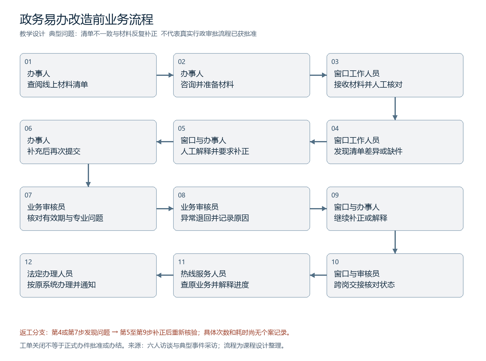
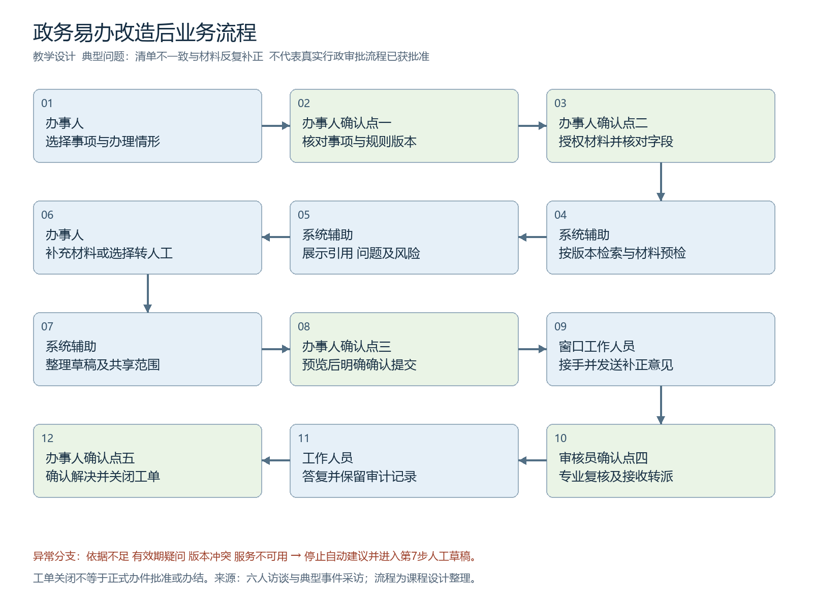

# 政务易办改造前后业务流程

两图围绕清单差异引发反复补正的典型问题展开。现状依据六人访谈，改造方案依据已有需求设计；本次典型事件采访没有完整单案计时，不能把设计流程写成已观察到的真实改造成果。

## 改造前流程

## 改造后流程

## 对应的改造点

清单差异通过事项及规则快照提前暴露；字段差异通过引用材料和本人核对处理；跨岗丢失说明通过冻结共享范围、关联预检和确认接手处理。有效期疑问、依据不足、版本冲突或服务不可用时停止自动建议，经草稿预览后转人工；补充资料后重新确认及预检。

图中的正常路径不代表每个咨询必须转工单。可自助解决时结束咨询；只有未解决问题进入人工链。工作人员答复后，用户可以继续补充、确认解决，或按既有14天等待规则处理；默认关闭需单列，不当作实际问题解决。正式申请和行政审批仍在原政务系统完成。
