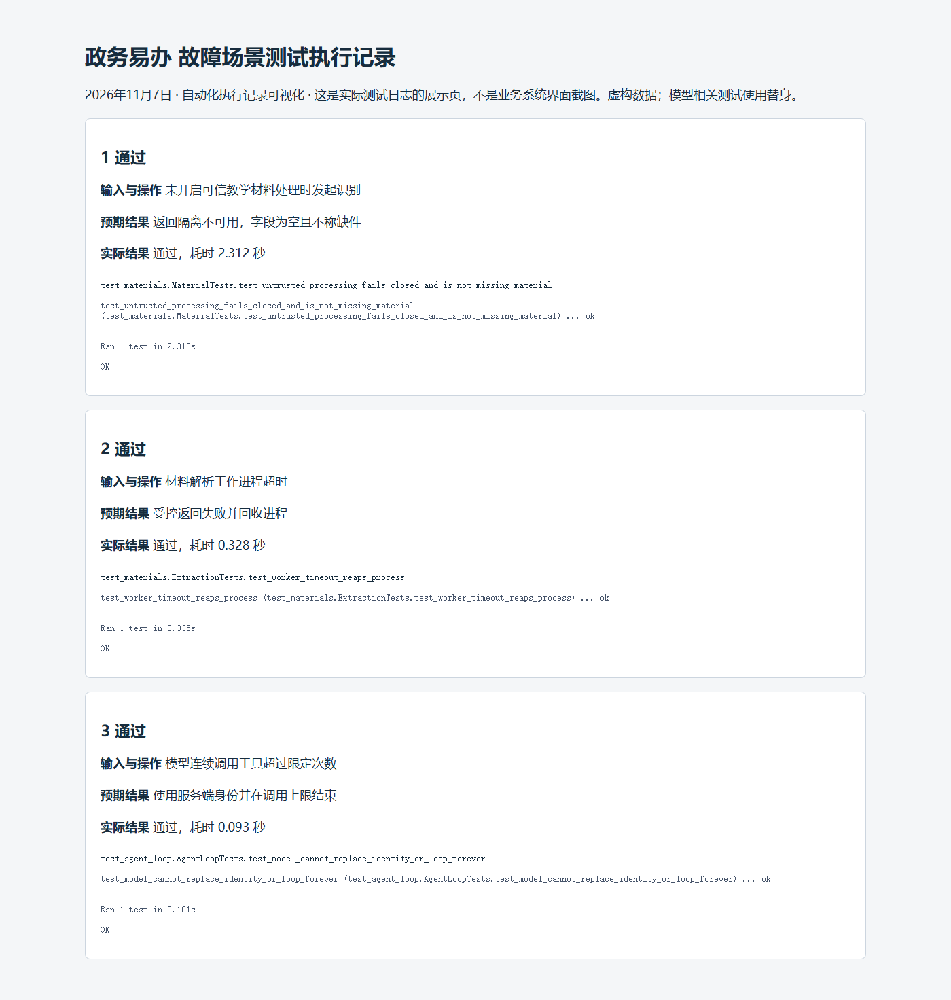
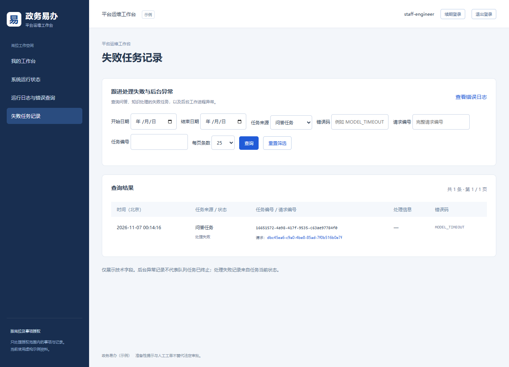

# 政务易办故障场景测试过程

执行日期为2026年11月7日。本报告记录3项代表性测试，通过3项，失败或跳过0项。测试使用隔离的虚构资料；模型相关行为采用替身响应。本报告不宣称覆盖该类所有情况。

## 测试方法

使用Python unittest运行原仓库中的实际用例，执行文件、类和方法编号如下。每项按夹具建立数据、设置输入或故障、调用真实业务服务或ASGI接口、断言结果，最后清理隔离数据。完整输出位于证据目录，图为本次真实输出的可视化，不是人工编造的业务页面。

## 用例1

输入与操作：未开启可信教学材料处理时发起识别。

执行顺序：准备独立夹具 → 注入上述输入或条件 → 调用对应实现 → 核对断言 → 清理测试数据。

预期结果：返回隔离不可用，字段为空且不称缺件。

实际结果：通过，运行耗时2.312秒。

用例编号：test_materials.MaterialTests.test_untrusted_processing_fails_closed_and_is_not_missing_material。源码见src/MVP项目/tests中的同名文件，完整断言及测试数据可直接核对。

## 用例2

输入与操作：材料解析工作进程超时。

执行顺序：准备独立夹具 → 注入上述输入或条件 → 调用对应实现 → 核对断言 → 清理测试数据。

预期结果：受控返回失败并回收进程。

实际结果：通过，运行耗时0.328秒。

用例编号：test_materials.ExtractionTests.test_worker_timeout_reaps_process。源码见src/MVP项目/tests中的同名文件，完整断言及测试数据可直接核对。

## 用例3

输入与操作：模型连续调用工具超过限定次数。

执行顺序：准备独立夹具 → 注入上述输入或条件 → 调用对应实现 → 核对断言 → 清理测试数据。

预期结果：使用服务端身份并在调用上限结束。

实际结果：通过，运行耗时0.093秒。

用例编号：test_agent_loop.AgentLoopTests.test_model_cannot_replace_identity_or_loop_forever。源码见src/MVP项目/tests中的同名文件，完整断言及测试数据可直接核对。

## 实际执行记录图

## 证据解释与限制

可视化执行记录逐项对应原始测试日志；若附有业务页面图，仅展示本次浏览器回归中相关流程，不将它当作全部接口断言的独立证明。未附业务图的断言以真实日志、用例和结果JSON核对。故障模拟和模型替身用于可重复注入条件，不能用来证明真实供应商可用性。
