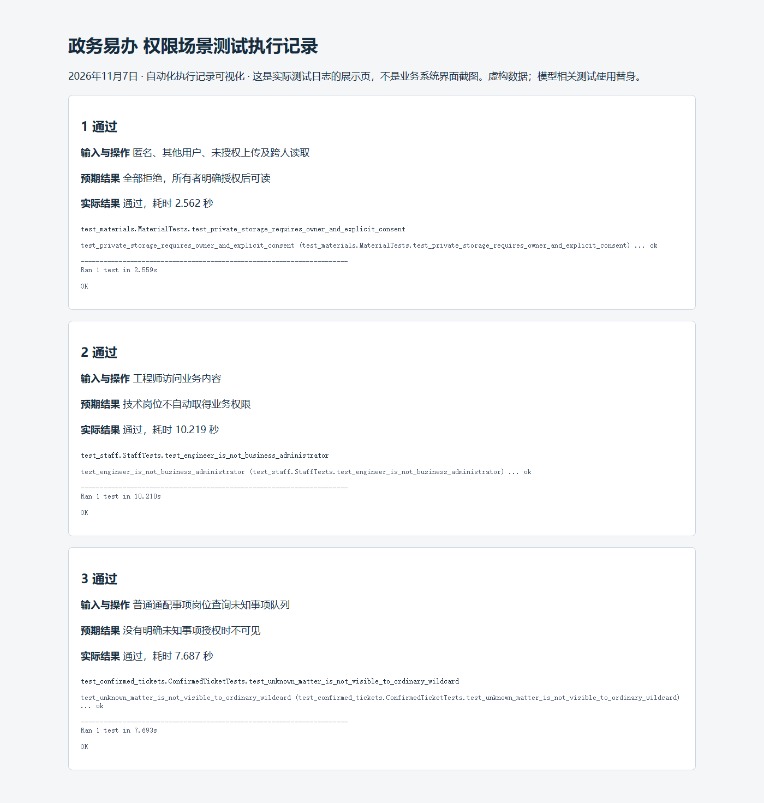
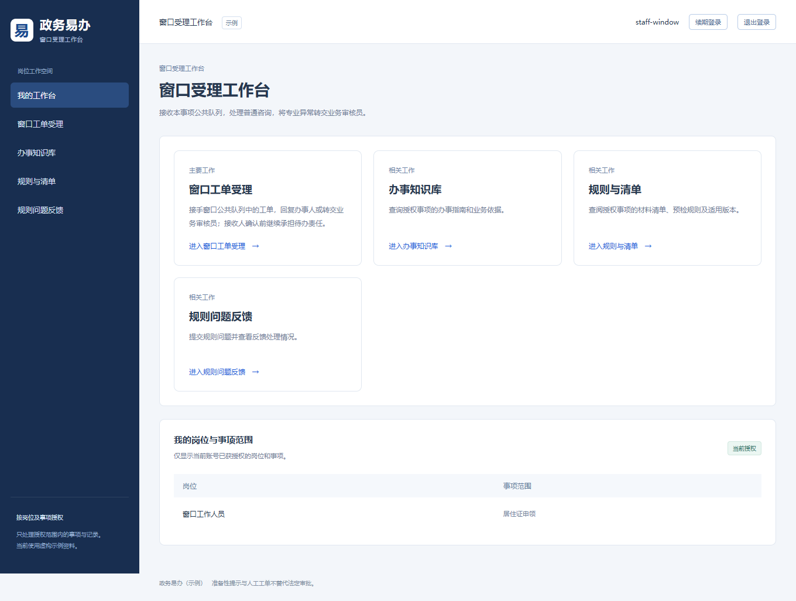
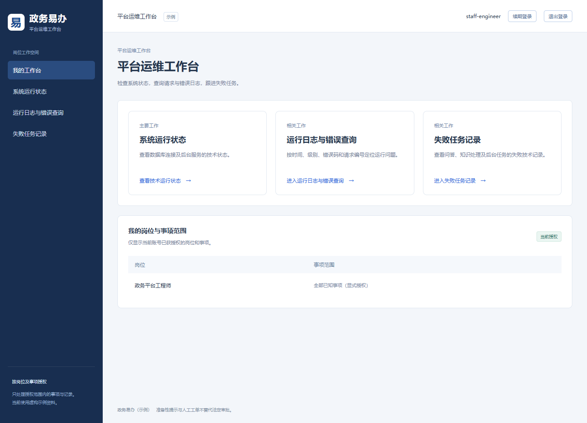

# 政务易办权限场景测试过程

执行日期为2026年11月7日。本报告记录3项代表性测试，通过3项，失败或跳过0项。测试使用隔离的虚构资料；模型相关行为采用替身响应。本报告不宣称覆盖该类所有情况。

## 测试方法

使用Python unittest运行原仓库中的实际用例，执行文件、类和方法编号如下。每项按夹具建立数据、设置输入或故障、调用真实业务服务或ASGI接口、断言结果，最后清理隔离数据。完整输出位于证据目录，图为本次真实输出的可视化，不是人工编造的业务页面。

## 用例1

输入与操作：匿名、其他用户、未授权上传及跨人读取。

执行顺序：准备独立夹具 → 注入上述输入或条件 → 调用对应实现 → 核对断言 → 清理测试数据。

预期结果：全部拒绝，所有者明确授权后可读。

实际结果：通过，运行耗时2.562秒。

用例编号：test_materials.MaterialTests.test_private_storage_requires_owner_and_explicit_consent。源码见src/MVP项目/tests中的同名文件，完整断言及测试数据可直接核对。

## 用例2

输入与操作：工程师访问业务内容。

执行顺序：准备独立夹具 → 注入上述输入或条件 → 调用对应实现 → 核对断言 → 清理测试数据。

预期结果：技术岗位不自动取得业务权限。

实际结果：通过，运行耗时10.219秒。

用例编号：test_staff.StaffTests.test_engineer_is_not_business_administrator。源码见src/MVP项目/tests中的同名文件，完整断言及测试数据可直接核对。

## 用例3

输入与操作：普通通配事项岗位查询未知事项队列。

执行顺序：准备独立夹具 → 注入上述输入或条件 → 调用对应实现 → 核对断言 → 清理测试数据。

预期结果：没有明确未知事项授权时不可见。

实际结果：通过，运行耗时7.687秒。

用例编号：test_confirmed_tickets.ConfirmedTicketTests.test_unknown_matter_is_not_visible_to_ordinary_wildcard。源码见src/MVP项目/tests中的同名文件，完整断言及测试数据可直接核对。

## 实际执行记录图

## 证据解释与限制

可视化执行记录逐项对应原始测试日志；若附有业务页面图，仅展示本次浏览器回归中相关流程，不将它当作全部接口断言的独立证明。未附业务图的断言以真实日志、用例和结果JSON核对。故障模拟和模型替身用于可重复注入条件，不能用来证明真实供应商可用性。
